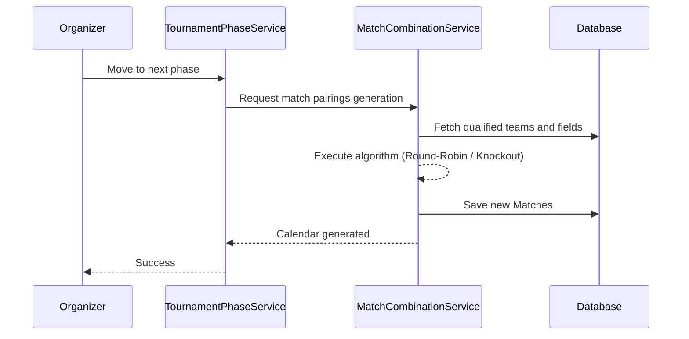
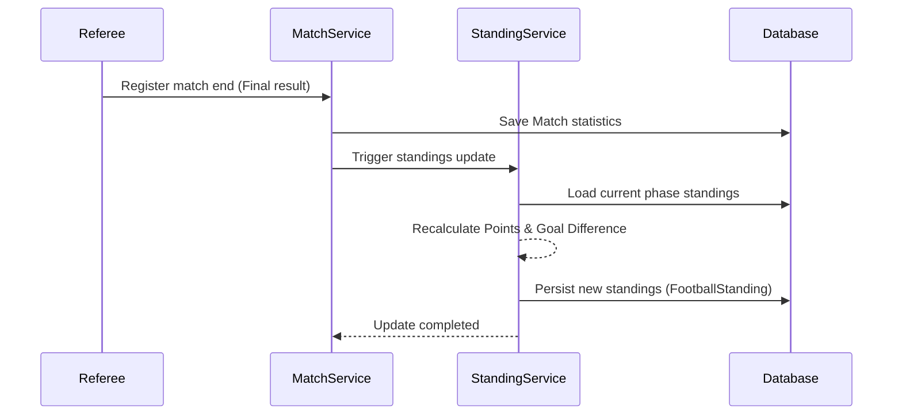
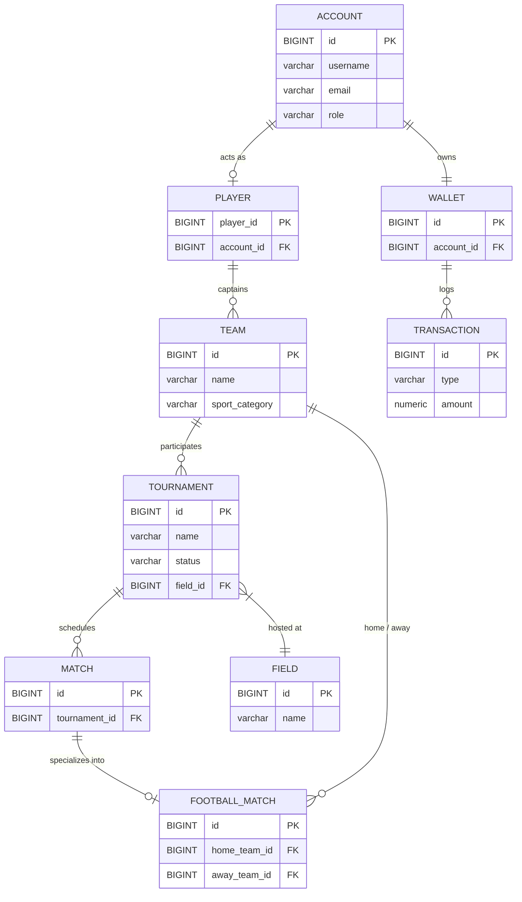

# ATL - Core Backend API


> A robust, near-production stage backend platform powering complex sports tournament management, coordinating team registrations, dynamic scheduling, and secure financial processing.

---

📱 **Frontend Application:** This backend powers the ATL mobile app. [View the Flutter repository here](https://github.com/lorisdj02/atl_app)

---

## 🏛 Architecture & Core Pattern

The project follows a **Layered Architecture** utilizing the **MVC (Model-View-Controller)** pattern. Business logic is strictly decoupled from presentation, employing specialized **Orchestrators** (e.g., `PurchasesOrchestrator`, `ReviewsOrchestrator`) to elegantly manage complex transactional flows and cross-domain operations (such as completing a payment and enrolling a team in a tournament simultaneously).

---

## ⚙️ Key Features & System Flows

The backend handles highly articulated domain logic to ensure the entire tournament ecosystem is seamless, from enrollment to prize distribution and reviews.

### 1. Match Generation and Pairings
The pairing logic is dynamically managed based on the tournament phase (e.g., round-robin or knockout). The `MatchCombinationService` handles fair generation of matchups, coordinating team availability and automatically assigning available `Field`s.



### 2. Real-Time Standings Update
During a match, every significant event (goals, penalties) is promptly handled. At the end of the match, the `TournamentStandingService` dynamically recalculates the standings, updating points, goal differences, and overall statistics, ensuring data consistency.



### 3. Reviews Orchestration
The `ReviewsOrchestrator` acts as a vital layer at the end of an event, ensuring that reviews for organizers and referees are enabled only when a tournament concludes. It atomically updates global average ratings and distributes the evaluation outcomes.

```mermaid
flowchart LR
    A[Tournament Ends] --> B{Did the user<br/>participate?}
    B -- Yes --> C[Unlock Review Form]
    B -- No --> D[Review Denied]
    C --> E[Submit Review (Score 1-5)]
    E --> F[ReviewsOrchestrator]
    F --> G[(Database: Save Review)]
    F --> H[(Database: Update Average Rating)]
```

---

## 💾 Data Model (ER Diagram)

Below is a consolidated Entity-Relationship diagram highlighting the core entities across the major bounded contexts (Accounts, Tournaments, and Finances).



---

## 🔌 API Overview

The REST API exposes structured endpoints based on core controllers. 

| Method | Endpoint | Description | Domain |
| :--- | :--- | :--- | :--- |
| **POST** | `/api/v1/accounts/login` | Authenticates the user and returns context with various roles. | Accounts |
| **GET** | `/api/v1/tournaments/{sportCategory}/filters` | Advanced tournament search (filters by city, fee, team size, prize pool). | Tournaments |
| **POST** | `/api/v1/tournaments/tournament/{id}/confirm-callups` | Official confirmation of called-up players (Call-ups) for an enrolled team. | Teams / Tournaments |
| **POST** | `/api/v1/payments/checkout-session/create` | Initializes a secure checkout session (e.g. for entry fee). | Financial |
| **PATCH** | `/api/v1/payments/checkout-session/{id}/pay` | Executes payment by deducting Wallet funds or confirming Stripe intent. | Financial |
| **PATCH** | `/api/v1/accounts/review/commit` | Confirms and persists a post-tournament review via Orchestrator. | Accounts |

---

## 🚀 Known Limitations & Future Roadmap

The system is currently in a **near-production stage**. While the core architecture is highly robust, there are a few final features required before a full public release:

1. **WebSockets for Real-Time Updates:** Currently, match events and standings are updated synchronously via REST. Integrating WebSockets (e.g., STOMP over WebSocket) is needed to push automatic live updates to clients when a match event (e.g., a goal) is added.
2. **Advanced Security & Restriction Checks:** Further fine-tuning of Spring Security is required to enforce strict role-based constraints, payload validation, and abuse prevention (rate limiting) across all endpoints.
3. **Asynchronous Processing:** Integration of a Message Broker (e.g., RabbitMQ or Apache Kafka) to decouple computationally heavy tasks, such as complex round-robin bracket generation or asynchronous Stripe webhooks.
4. **Cloud-Native Storage Migration:** Transitioning from local file storage (`.storage`) to a Cloud Object Storage (Amazon S3 or GCS) coupled with a CDN for fast, distributed asset delivery.

---

## 🛠 Local Setup

### Prerequisites
* Java 25
* PostgreSQL 16+

### Database Configuration
Verify that your local PostgreSQL instance is running with the default credentials (found in `application.properties`):
* **URL:** `jdbc:postgresql://localhost:5432/atl_database`
* **Username:** `postgres`
* **Password:** `postgres`

### Running the Application
The project uses Maven Wrapper. To boot the development server locally:

```bash
./mvnw spring-boot:run
```

The REST service will be listening on `http://localhost:8081`.
