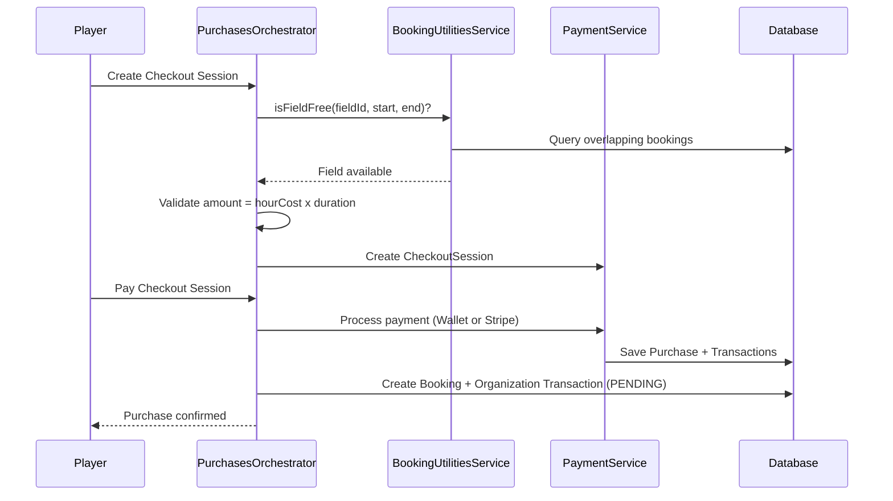
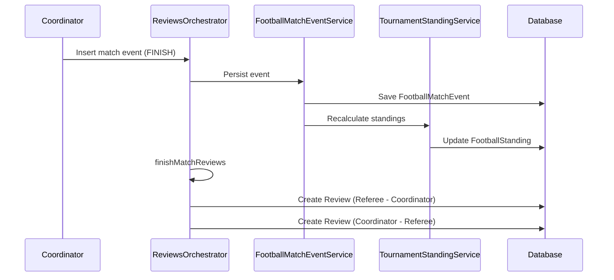
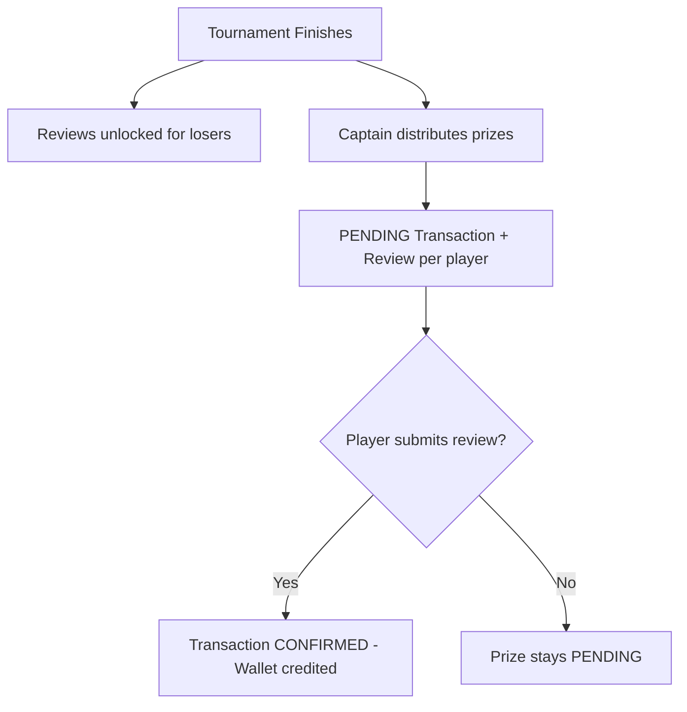
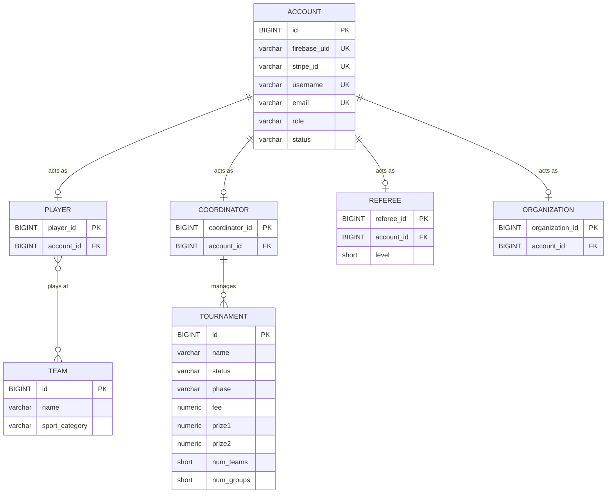
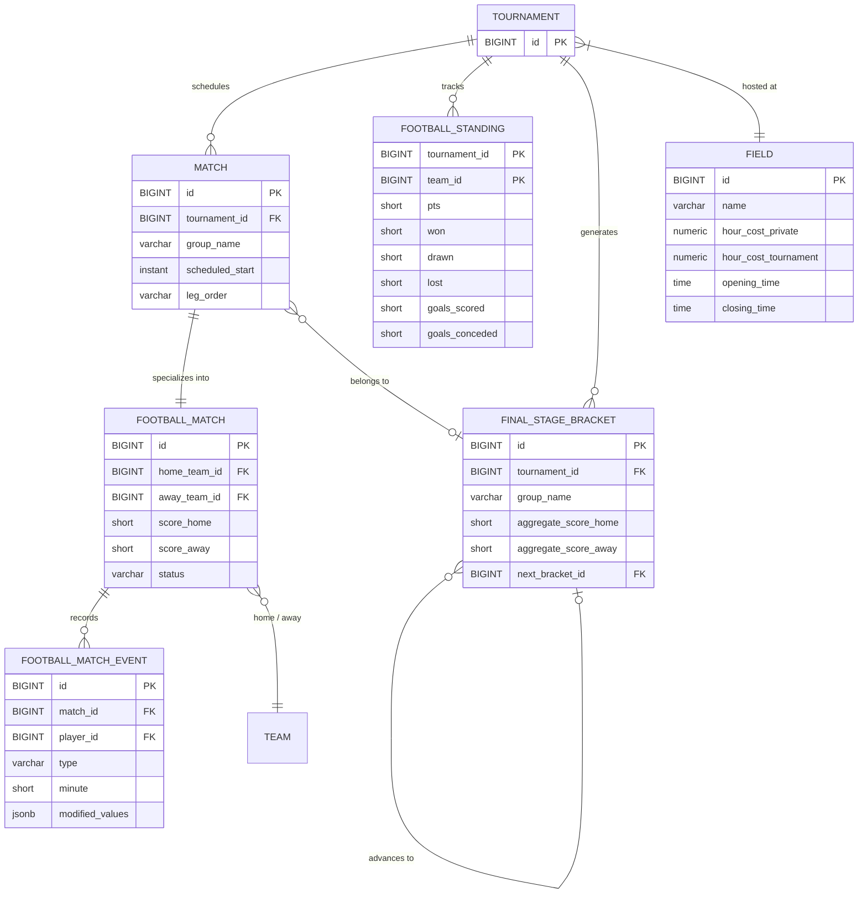
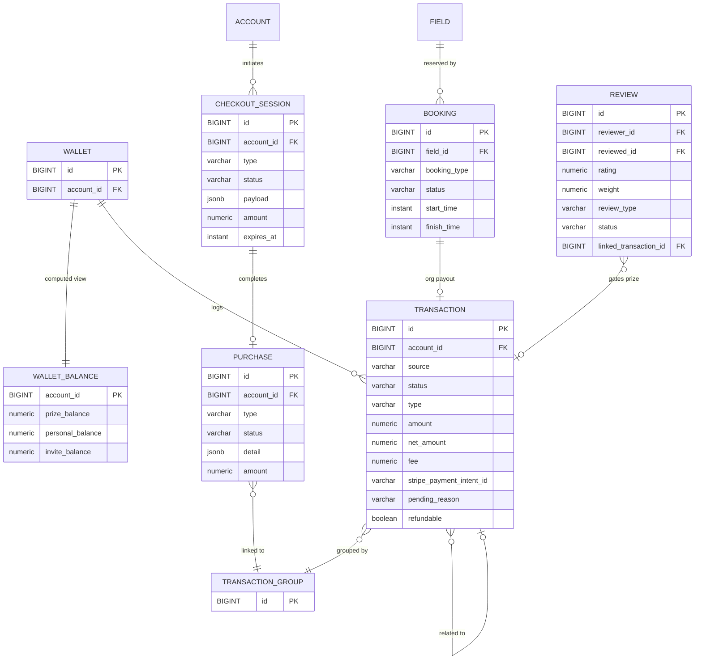

# ATL - Core Backend API


> A portfolio-grade backend platform for managing amateur sports tournaments end-to-end — from field bookings and team enrollment to live match events, dynamic standings, financial processing via Stripe, and a review-gated prize distribution system.

---

> 📱 **Frontend Application:** This backend powers the ATL mobile app. [View the Flutter repository here](https://github.com/lorisdj02/atl_app)

---

## 🏛 Architecture Overview

The project follows a **Layered Architecture** with the **MVC** pattern, organized into clearly separated packages:

| Layer | Package | Responsibility |
| :--- | :--- | :--- |
| **Presentation** | `controller` | REST endpoints, request validation |
| **Business Logic** | `service`, `service/orchestrator` | Domain rules, cross-domain transactional flows |
| **Persistence** | `repository`, `model` | JPA entities, Spring Data repositories |
| **Auth** | `auth` | `AccountContext` — thread-local identity for the authenticated user |
| **Cross-cutting** | `config`, `exception`, `dto`, `request`, `response` | Constants, global error handling, data transfer |

A key design decision is the **Orchestrator pattern**: services like `PurchasesOrchestrator` and `ReviewsOrchestrator` coordinate complex, multi-step transactions that span multiple bounded contexts (e.g., paying a checkout session → creating a booking → generating a pending organization transaction — all atomically via `@Transactional`).

### Four Account Roles

Every `Account` can act as one of these roles, each with dedicated home screens and capabilities:

| Role | Description |
| :--- | :--- |
| **Player** | Joins teams, books fields (private or lobby), participates in tournaments, gets called up for matches |
| **Coordinator** | Creates and manages tournaments, controls match lifecycle (start, finish, phase progression), assigns prizes |
| **Referee** | Self-assigns to available matches, records live match events (goals, cards, penalties), gets paid per match |
| **Organization** | Owns physical fields, receives revenue when bookings start via a scheduled job |

---

## ⚙️ Key Technical Features

### 1. Dual Booking System — Private & Lobby

Players can book fields in two ways:
- **Private Booking**: A single player reserves an entire field for a given time slot. The price is dynamically calculated based on the field's `hourCostPrivate` rate and the booking duration.
- **Lobby Booking**: A player creates a public lobby, and other players can join by paying their share. The total field cost is split equally across `totalPlayers`, and the `feePerPlayer` is computed at creation time. Other players join by purchasing `LOBBY_BOOKING_PARTICIPATE` checkout sessions.

**Concurrency control** is enforced at the service level: `BookingUtilitiesService.isFieldFree()` queries all existing bookings for that field in the requested time range, rejecting overlapping reservations with a `409 Conflict`. Opening/closing hours of each field are also validated.

**Refund policy** includes a time-based guard: bookings are only refundable if the start time is beyond a configurable threshold (`ATLCostants.getBookingRefundLimit()`), preventing last-minute abuse.



### 2. Deferred Payment to Organizations (Scheduled Job)

When a booking is created, a **pending `Transaction`** is generated for the field's `Organization`. This transaction is **not confirmed** until the booking actually starts (`BookingStatus.IN_PROGRESS`). The `PurchasesOrchestrator.startBooking()` method redeems all related purchases, marks transactions as non-refundable, and confirms the organization's payout — ensuring organizations are only paid for bookings that actually take place.

### 3. Dynamic Standings & Live Match Events

The `FootballMatchEventService` handles granular in-match events — a rich enum covering `START`, `HALFTIME`, `START_HALF`, `GOAL`, `OWN_GOAL`, `PENALTY`, `MISSED_PENALTY`, `YELLOW_CARD`, `RED_CARD`, `RED_YELLOW_CARD`, `PENALTY_SHOOTOUT`, and `FINISH`. Each event is persisted with minute, additional minute, team, player, and a `jsonb` column (`modifiedValues`) that captures the snapshot of all values the event modified.

When a `FINISH` event is inserted via the `ReviewsOrchestrator`, the system:
1. Persists the final match statistics
2. Triggers the `TournamentStandingService` to recalculate points, goal differences, and group standings
3. Automatically creates mutual review forms between the Referee and Coordinator



### 4. Review-Gated Prize Distribution

After a tournament finishes, the `ReviewsOrchestrator` orchestrates a controlled prize flow:
1. **Tournament Start** → Review forms are pre-created for all called-up players (weighted: captains = `1.0`, others = `0.5`)
2. **Tournament Finish** → Reviews are unlocked (`PENDING`) for non-winning participants
3. **Prize Assignment** → The winning team's captain distributes prize money per player. Each prize creates a `PENDING` transaction linked to the player's review — **the prize is only credited to the wallet once the review is submitted**



### 5. Tournament Phase Engine & Bracket Generation

Tournaments follow a strict phase lifecycle with ordered progression: `GROUP → RO32 → RO16 → QUARTER → SEMI → FINAL`. The `TournamentPhaseService` validates each transition, and the `MatchCombinationService` generates match pairings algorithmically for each phase.

The `FinalStageBracket` entity models a self-referencing tree structure — each bracket node tracks aggregate scores across legs and links to its `nextFinalStageBracket`, enabling seamless single/double-leg knockout progression through `HOME`/`AWAY` slots.

---

## 💾 Data Model (ER Diagrams)

### Core Domain — Accounts, Teams & Tournaments



### Match Engine — Scheduling, Events & Standings



### Financial Domain — Wallet, Payments & Bookings



---

## 🔌 API Overview

Endpoints are organized by domain across **10 REST controllers**, all prefixed with `/api/v1`.

### 🏠 Home & Profile

| Method | Endpoint | Description |
| :--- | :--- | :--- |
| **GET** | `/homes/player/{sportCategory}` | Player home screen with active bookings, teams, and upcoming tournaments |
| **GET** | `/homes/coordinator/{sportCategory}` | Coordinator dashboard with managed tournaments and match schedule |
| **GET** | `/homes/referee/{sportCategory}` | Referee hub with assigned and available matches |
| **GET** | `/homes/organization/{sportCategory}` | Organization overview with field bookings and revenue |
| **GET** | `/profiles/wallet` | Wallet balance and full transaction history |
| **GET** | `/profiles/purchases` | Complete purchase history across all checkout types |
| **GET** | `/profiles/personal-player-stats` | Aggregated player statistics across all tournaments |
| **GET** | `/profiles/growth-screen` | Growth level and progression milestones |

### 👤 Accounts

| Method | Endpoint | Description |
| :--- | :--- | :--- |
| **POST** | `/accounts/account/register` | Register a new account with Wallet creation and optional invite-code reward |
| **POST** | `/accounts/login` | Authenticate and return user context with all active roles |
| **POST** | `/accounts/account/update-infos` | Update profile (supports both JSON and `multipart/form-data` for avatar upload) |
| **PATCH** | `/accounts/review/commit` | Submit a review — triggers linked transaction confirmation if applicable |
| **DELETE** | `/accounts/account/delete` | Soft-delete account and cascade-clean all related data |

### ⚽ Teams & Tournaments

| Method | Endpoint | Description |
| :--- | :--- | :--- |
| **POST** | `/teams/create` | Create a new team for a given sport category |
| **POST** | `/teams/team/{id}/requests/send` | Send a join request to a team |
| **POST** | `/teams/team/{id}/manage/requests/accept` | Captain accepts player requests (single or batch) |
| **PATCH** | `/teams/team/{id}/promote-or-demote/{playerId}` | Promote/demote a player to vice-captain |
| **GET** | `/tournaments/{sportCategory}/filters` | Advanced tournament search (city, team size, fee range, prize range, name) |
| **POST** | `/tournaments/create` | Create and configure a new tournament |
| **POST** | `/tournaments/tournament/{id}/confirm-callups` | Confirm called-up players for a team's tournament participation |
| **PATCH** | `/tournaments/tournament/{id}/go-next-phase` | Advance tournament to the next phase (triggers match generation) |
| **PATCH** | `/tournaments/tournament/{id}/assign-prizes` | Distribute prize money to winning/finalist players |

### 🏟 Bookings & Matches

| Method | Endpoint | Description |
| :--- | :--- | :--- |
| **GET** | `/bookings/book-a-field/{sportCategory}` | Booking screen with available fields and cities |
| **GET** | `/bookings/free-fields/...` | Find available fields with concurrency check and dynamic pricing |
| **GET** | `/bookings/join-lobby-screen/{sport}/city/{id}` | Browse open lobbies with filters (players, time range) |
| **DELETE** | `/bookings/private-booking/{id}/refund` | Refund a private booking (enforces time-based refund policy) |
| **DELETE** | `/bookings/lobby-booking/{id}/leave` | Leave or refund a lobby booking (owner vs participant logic) |
| **POST** | `/matches/match/{id}/football-event/insert` | Record a live match event (goal, card, start, finish, penalty shootout) |
| **POST** | `/matches/match/{id}/insert-referee-assignment/{role}` | Referee self-assigns to an available match |
| **GET** | `/matches/{sport}/referee/available-matches` | List unassigned matches a referee can claim |
| **PATCH** | `/matches/match/{id}/add-motm/{playerId}` | Select Man of the Match |

### 💳 Payments

| Method | Endpoint | Description |
| :--- | :--- | :--- |
| **POST** | `/payments/checkout-session/create` | Initialize a checkout session (`TOURNAMENT_FEE`, `PRIVATE_BOOKING`, `LOBBY_BOOKING_CREATE`, `LOBBY_BOOKING_PARTICIPATE`) |
| **PATCH** | `/payments/checkout-session/{id}/pay` | Execute payment via Wallet balance and/or Stripe PaymentIntent |
| **POST** | `/payments/checkout-session/{id}/create-payment-intent` | Generate a Stripe PaymentSheet for client-side confirmation |

---

## 🚧 Known Limitations & Engineering Notes

This project is built as a **portfolio piece** to demonstrate architectural competence with Java/Spring Boot, relational database design, and complex domain modeling. The core architecture and business logic are fully functional. Below are the known gaps and areas of improvement:

| Area | Current State | Improvement |
| :--- | :--- | :--- |
| **Real-Time Updates** | Clients must poll REST endpoints for match/standings changes | Integrate WebSockets (STOMP over SockJS) to push live events when a goal or match event is inserted |
| **Authentication** | `AuthFilter` currently treats the Bearer token as a username lookup (Firebase UID validation is stubbed via `validateAndExtractUid`) | Implement real Firebase Admin SDK token verification, replacing the current identity-by-username approach |
| **Authorization** | Spring Security `filterChain` permits all requests (`anyRequest().permitAll()`); role checks are done manually in services | Enforce endpoint-level role-based access via `@PreAuthorize` annotations and Spring Security's method security |
| **Booking Concurrency** | Field availability is checked at the application level with `isFieldFree()` query | Add a database-level pessimistic lock or `SELECT ... FOR UPDATE` to prevent race conditions under high concurrency |
| **Checkout Session Expiry** | `CheckoutSession.expiresAt` is set (10 min) but no scheduled job cleans up expired sessions | Implement a `@Scheduled` task to expire stale `PENDING` sessions and release reserved resources |
| **Async Processing** | Stripe payment capture, bracket generation, and batch notifications are handled synchronously | Offload to a message broker (RabbitMQ/Kafka) for non-blocking execution |
| **File Storage** | Avatar/image uploads are saved to a local `.storage/` directory | Migrate to cloud object storage (S3/GCS) with CDN for distributed delivery |
| **Test Coverage** | Test dependencies are included (`spring-boot-starter-*-test`) but test suites are not yet written | Add unit and integration tests for orchestrators and critical payment flows |

---

## 🛠 Local Setup

### Prerequisites
- **Java 25**
- **PostgreSQL 16+**
- **Maven** (wrapper included)

### Database Configuration
Ensure PostgreSQL is running locally with these default credentials (from `application.properties`):

| Property | Value |
| :--- | :--- |
| URL | `jdbc:postgresql://localhost:5432/atl_database` |
| Username | `postgres` |
| Password | `postgres` |

### Running the Application

```bash
./mvnw spring-boot:run
```

The REST API will be available at **`http://localhost:8081`**.
